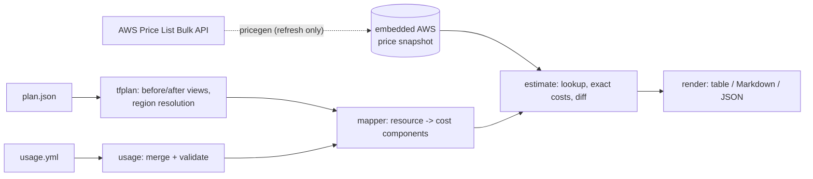

# planprice

[](https://github.com/guneshm03/planprice/actions/workflows/ci.yml)

**Monthly AWS cost estimates and cost diffs for Terraform plans, computed offline from a pinned AWS price snapshot, with Markdown output ready to post on a pull request.**

```console
$ planprice diff --base main.json --head pr.json --usage usage.yml --format markdown
### planprice: monthly cost will increase by **+$3,193.07** (+624.0%)
```

planprice reads the JSON form of a Terraform plan (`terraform show -json`),
maps each supported AWS resource to its billable components (instance hours,
GB-months, IOPS, requests, LCU-hours, ...), prices them against an embedded,
checksummed subset of the public AWS Price List, and reports a monthly
breakdown or a resource-by-resource diff between two plans.

It is for platform and FinOps engineers who want a cost signal in code review
without sending plans to a SaaS, holding AWS credentials in CI, or trusting
numbers that change between runs. It is not a replacement for Infracost or
the AWS Pricing Calculator; see
[Limitations](#limitations).

## What it does

- **Breakdown** of a plan's monthly cost, per resource and per component, as a
  terminal table, PR-comment Markdown or JSON.
- **Diff** between two plans (`--base`/`--head`, e.g. main vs. PR branch) or
  between a single plan's prior state and planned state (`--plan`); components
  are matched by stable keys, so `t3.medium -> m6i.large` is one changed line.
- **CI gate**: `--fail-above-increase 500` / `--fail-above-percent 20` exit
  with code 3 when the monthly increase is too large.
- **Usage files** (YAML) for what a plan cannot know: Lambda requests, S3 GB
  stored, NAT GB processed, load-balancer capacity units. Validated against
  each resource's schema (typos are errors); `usage-template` generates one.
- **Mappers** for EC2 (`aws_instance` incl. root/EBS block devices and CPU
  credits), EBS (`aws_ebs_volume`, gp2/gp3/io1/io2/st1/sc1/standard, io2 IOPS
  tiers), RDS (`aws_db_instance`, MySQL/MariaDB/PostgreSQL, Single/Multi-AZ,
  gp3 baselines), S3 (`aws_s3_bucket`, six storage classes, tiered storage,
  requests, retrieval), NAT gateway, ELB (`aws_lb`/`aws_alb` ALB/NLB/GWLB and
  classic `aws_elb`) and Lambda (x86_64/arm64, tiered duration, ephemeral
  storage). Full reference: [docs/RESOURCES.md](docs/RESOURCES.md).
- **Honest output**: everything that is not priced (unsupported types,
  attributes unknown until apply, missing usage, prices not in the snapshot)
  is counted and listed, never silently treated as $0.
- **Price snapshot tooling**: `pricegen` streams the AWS bulk offer files
  (the EC2 one is ~480 MB) into a 1.8 MB curated snapshot; `planprice snapshot
  diff` reviews a refresh. See [docs/PRICE_SNAPSHOT.md](docs/PRICE_SNAPSHOT.md).

## Architecture



Mappers are pure functions from planned attributes plus usage to
components (quantity + price query); the estimate package does all lookups,
so each mapper is tested in isolation with hand-computed prices. All money is
exact (`math/big.Rat`) and rounded only for display. Details, algorithms and
complexity: [docs/ARCHITECTURE.md](docs/ARCHITECTURE.md).

## Quickstart

Requires Go 1.25+. No AWS credentials, network or Terraform needed to estimate.

```sh
git clone https://github.com/guneshm03/planprice && cd planprice
make build                      # -> bin/planprice
make demo                       # offline end-to-end run on the bundled plans

# Your own plan:
terraform plan -out tf.plan && terraform show -json tf.plan > plan.json
bin/planprice usage-template --plan plan.json > usage.yml   # fill in what you know
bin/planprice breakdown --plan plan.json --usage usage.yml
```

Commands:

| Command | Purpose |
|---|---|
| `planprice breakdown --plan P [--usage U] [--format table\|markdown\|json] [--view after\|before]` | Monthly cost of a plan |
| `planprice diff --base A --head B [--usage U] [--fail-above-increase USD] [--fail-above-percent N]` | Cost change between two plans |
| `planprice diff --plan P` | Prior state vs. planned state of one plan |
| `planprice usage-template --plan P` | Commented usage-file skeleton for the plan's resources |
| `planprice resources [--format markdown]` | Supported resources, usage keys, assumptions |
| `planprice snapshot info\|verify\|lookup\|diff` | Inspect, verify and compare price snapshots |

Shared flags: `--region` (fallback when the plan does not determine a
resource's region; default `us-east-1`), `--snapshot` (use a snapshot file
instead of the embedded one), `--out`, `--verbose`. Exit codes: 0 ok,
1 error, 2 usage error, 3 cost threshold exceeded.

### In GitHub Actions

```yaml
- run: |
    terraform -chdir=infra plan -out base.plan   # on the base commit
    terraform -chdir=infra show -json base.plan > base.json
    # ... check out the PR head, plan again into head.json ...
    planprice diff --base base.json --head head.json --usage infra/usage.yml \
      --format markdown --out cost.md --fail-above-increase 500
```

The Markdown starts with `<!-- planprice:cost-diff -->` so a bot can find and
update its previous comment instead of posting a new one. The repository's
own [CI workflow](.github/workflows/ci.yml) runs this against the bundled
plans and writes the result to the job summary.

### Usage files

```yaml
version: 1
defaults:                              # by resource type (lowest precedence)
  aws_lambda_function:
    request_duration_ms: 300
resource_usage:
  aws_lambda_function.workers[*]:      # [*] matches any count/for_each key
    monthly_requests: 250000
    request_duration_ms: 2400          # exact address > pattern > defaults
  module.data.aws_s3_bucket.assets:
    storage_classes:
      standard: {storage_gb: 2500, monthly_tier_2_requests: 12000000}
      standard_infrequent_access: {storage_gb: 8000, monthly_retrieval_gb: 300}
```

Unknown keys, wrong types and negative values are errors; entries that match
no resource in the plan produce a warning.

## Demo output

From `make demo` (real output, abridged; the bundled plans come from
`examples/` via real `terraform plan` runs against a mock provider):

```text
==> Monthly cost of the head plan, with usage assumptions
$ planprice breakdown --plan testdata/plans/head.json --usage examples/usage.yml

NAME                                                       MONTHLY QTY  UNIT                   UNIT PRICE  MONTHLY COST

aws_ebs_volume.journal (us-east-1)                                                                            $2,506.50
├─ Storage (io2)                                                   500  GB-months                  $0.125        $62.50
├─ Provisioned IOPS 0-32,000 (io2)                              32,000  IOPS-months                $0.065     $2,080.00
└─ Provisioned IOPS 32,001-64,000 (io2)                          8,000  IOPS-months               $0.0455       $364.00

aws_lambda_function.workers["ocr"] (us-east-1)                                                                   $16.08
├─ Requests                                                       0.25  million requests            $0.20         $0.05
├─ Duration (2048 MB, arm64)                                 1,200,000  GB-seconds         $0.0000133334*        $16.00
└─ Ephemeral storage above 512 MB (2048 MB)                    900,000  GB-seconds          $0.0000000309         $0.03

module.data.aws_db_instance.main (us-east-1)                                                                    $481.39
├─ Database instance (PostgreSQL, Multi-AZ, db.m6g.large)          730  hours                      $0.318       $232.14
├─ Storage (gp3)                                                   500  GB-months                   $0.23       $115.00
├─ Provisioned IOPS above 12,000 (gp3)                           3,000  IOPS-months                 $0.04       $120.00
└─ Additional backup storage                                       150  GB-months                  $0.095        $14.25

module.data.aws_s3_bucket.assets (us-east-1)                                                                    $167.30
├─ standard
│  ├─ Storage                                                    2,500  GB-months                 $0.023*        $57.50
│  ├─ PUT, COPY, POST, LIST requests                               400  thousand requests          $0.005         $2.00
│  └─ GET and other requests                                    12,000  thousand requests         $0.0004         $4.80
└─ standard_infrequent_access
   ├─ Storage                                                    8,000  GB-months                 $0.0125       $100.00
   └─ Data retrieval                                               300  GB                          $0.01         $3.00

module.web.aws_instance.web[0] (us-east-1)                                                                       $74.08
├─ Instance usage (Linux, on-demand, m6i.large)                    730  hours                      $0.096        $70.08
└─ root_block_device
   └─ Storage (gp3)                                                 50  GB-months                   $0.08         $4.00
...
OVERALL TOTAL                                                                                                 $3,704.82

15 resources priced, 7 resources free, 2 resources not supported.
Unsupported resource types: aws_eip (2)
* tiered price: unit price shown is the blended rate for the quantity.
Prices: AWS Price List Bulk API (public, on-demand terms only), snapshot 2026-10-25; 730 hours/month.

==> Cost diff base -> head as a pull-request comment (Markdown)
<!-- planprice:cost-diff -->
### planprice: monthly cost will increase by **+$3,193.07** (+624.0%)

| | Monthly cost |
|---|---:|
| Base `testdata/plans/base.json` | $511.74 |
| Head `testdata/plans/head.json` | $3,704.82 |
| **Change** | **+$3,193.07 (+624.0%)** |

| Resource | Change | Base | Head | Diff |
|---|---|---:|---:|---:|
| `aws_ebs_volume.journal` | added | - | $2,506.50 | +$2,506.50 |
| `aws_ebs_volume.scratch` | changed | $20.00 | $26.00 | +$6.00 |
| `aws_lambda_function.thumbnailer` | changed | $6.80 | $10.40 | +$3.60 |
| `module.data.aws_db_instance.main` | changed | $78.31 | $481.39 | +$403.08 |
| `module.web.aws_instance.web[0]` | changed | $32.77 | $74.08 | +$41.31 |
| `module.web.aws_nat_gateway.egress[1]` | added | - | $59.85 | +$59.85 |
...

==> CI gate: fail when the monthly increase exceeds $500
exit code: 3 (3 = threshold exceeded)
```

Full outputs for every format are kept as golden files in
[`internal/render/testdata/`](internal/render/testdata/).

## Accuracy: how prices are checked

There is no "accuracy" metric to report: planprice multiplies quantities by
published list prices, so correctness means (a) the right price is selected
and (b) the arithmetic is right. Both are tested against hand calculations:

- Every mapper has tests whose expected costs are worked out by hand from the
  unit prices, with the arithmetic in a comment (e.g. io2 at 70,000 IOPS:
  `32,000 x 0.065 + 32,000 x 0.0455 + 6,000 x 0.03185 = 3,727.10` plus storage;
  S3 Standard at 60,000 GB: `51,200 x 0.023 + 8,800 x 0.022 = 1,371.20`).
  See `internal/mapper/*_test.go`.
- The base plan's total ($198.871 without usage) is checked against a hand
  sum in `internal/estimate/estimate_test.go`.
- `internal/pricedata` tests spot-check one well-known price per service
  in the embedded snapshot and verify its SHA-256.

## Tests, coverage and benchmarks

Every number below comes from the command next to it (run on the build
machine, Apple Silicon, Go 1.27.1; benchmarks vary with load).

| Measure | Value | Command |
|---|---|---|
| All gates (gofmt, golangci-lint, go vet, tests with `-race`, coverage) | pass | `make check` |
| Coverage of `internal/` | 95.1% (gate: 80%) | `make cover` |
| Test functions | 93 (126 including subtests) | `go test -count=1 -v ./... \| grep -cE '^--- PASS'` |
| Non-test Go source | 5,336 lines incl. comments | `find cmd internal -name '*.go' ! -name '*_test.go' \| xargs wc -l` |
| Load + validate embedded snapshot (7,587 prices) | ~22 ms | `make bench` (`BenchmarkLoadSnapshot`) |
| One price lookup | ~270 ns | `make bench` (`BenchmarkLookup`) |
| Estimate the 15-resource head plan | ~0.13 ms | `make bench` (`BenchmarkEstimateHeadPlan`) |
| Estimate 5,000 EC2 instances | ~32 ms | `make bench` (`BenchmarkEstimate5000Instances`) |

Test kinds: hand-computed price tests per mapper, real Terraform plans,
a synthetic plan for update/delete/replace and module-scoped providers,
golden files for each output format, property tests (exact arithmetic, tier
monotonicity, diff self-identity and antisymmetry) and fuzz tests for every
parser (`go test -fuzz FuzzParse ./internal/tfplan`, etc.).

## Design decisions

The full list with trade-offs is in [DECISIONS.md](DECISIONS.md). The main ones:

- **Embedded snapshot, not a live API**: reproducible estimates, no
  credentials, works in sandboxed CI; refreshed deliberately via a reviewed
  commit ([docs/PRICE_SNAPSHOT.md](docs/PRICE_SNAPSHOT.md)).
- **Unpriced is never zero**: missing usage, unknown attributes and absent
  prices are explicit statuses, listed in every output; totals are lower
  bounds until usage is supplied, and the reports say so.
- **Exact decimals**: AWS prices have ten decimal places; costs are summed
  exactly and rounded once, for display.
- **Pure mappers**: resource -> components without lookups, so each pricing
  rule is a small, testable function.
- **Stable component keys** make diffs read like a reviewer thinks:
  "instance: t3.medium -> m6i.large, +$39.71".

## Limitations

- **Two regions only** (us-east-1, eu-west-1). Resources elsewhere are listed
  with `price-not-found` and a warning. Adding a region is a documented
  change, but needs a ~1 GB snapshot refresh.
- **Nine resource types.** Everything else (CloudFront, DynamoDB, EKS,
  ElastiCache, EIPs, VPC endpoints, CloudWatch, ...) is listed as
  unsupported and excluded from totals. A known-free list (VPCs, subnets,
  IAM, security groups, ...) is reported as free.
- **On-demand list prices only.** No Reserved Instances, Savings Plans, Spot,
  EDP/private pricing, taxes, or credits. Free tiers are not deducted, and
  volume tiers (S3, Lambda) are applied per resource rather than per account.
- **No data transfer pricing** (internet egress, inter-AZ, inter-region),
  which is often a large share of real bills.
- **Usage is user-supplied.** Without a usage file, usage-based costs (most
  of S3 and Lambda) are excluded; with one, the estimate is only as good as
  the figures in it.
- **Assumptions where plans are silent**: Linux unless told otherwise,
  unknown root volumes priced as 8 GB gp2, unset RDS storage as gp2. Each is
  visible in component names or notes, and listed per resource in
  [docs/RESOURCES.md](docs/RESOURCES.md).
- **Prices age.** The snapshot is dated 2026-10-25; AWS changes prices
  without notice. `planprice snapshot info` shows the offer versions used.
- **Test plans are fictional**: real Terraform output, but generated against
  a mock provider for invented infrastructure, and create-only. Update and
  delete handling is tested with a hand-written plan.
- Early-stage: no known production users.

## Roadmap

- More regions in the default snapshot, selected per build.
- Data transfer (NAT/internet egress, inter-AZ) as usage-based components.
- More resource types: DynamoDB, ElastiCache, EKS clusters/node groups,
  CloudWatch logs, EIPs (public IPv4), VPC endpoints.
- Savings Plans / Reserved Instance rates as an optional pricing mode.
- Account-level tier aggregation across resources for S3 and Lambda.
- A GitHub Action wrapper that upserts the PR comment using the marker.

## Repository layout

```text
cmd/planprice, cmd/pricegen   entry points
internal/                     packages (see docs/ARCHITECTURE.md)
internal/pricedata/           embedded price snapshot + checksum
examples/                     Terraform configs and usage files
testdata/plans/               plans generated from examples/
scripts/                      gen-plans.sh (network), demo.sh (offline)
docs/                         ARCHITECTURE, PRICE_SNAPSHOT, RESOURCES
```

## License

MIT, see [LICENSE](LICENSE). AWS price data in the snapshot is AWS's; see
[DATA.md](DATA.md).

## Maintainer

Originally published under the `guneshm03` GitHub account; currently
maintained by Gunesh Mahajan.

- Email: [guneshmahajan574@gmail.com](mailto:guneshmahajan574@gmail.com)
- LinkedIn: [linkedin.com/in/guneshm007](https://www.linkedin.com/in/guneshm007/)