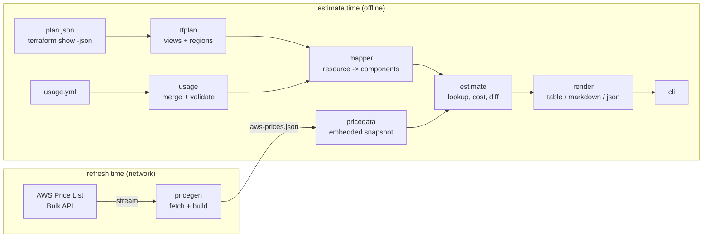
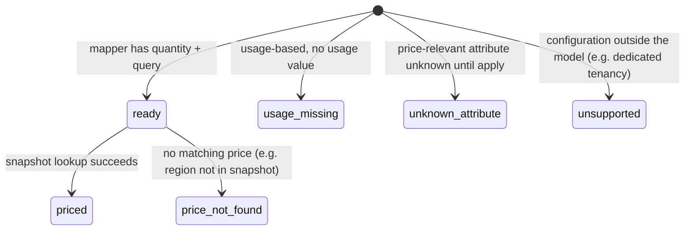

# Architecture

planprice is a pipeline of small packages with one-way dependencies. The
estimating path is pure and offline; the only networked code is the snapshot
builder (`cmd/pricegen`), which runs when a maintainer refreshes prices.

## Packages

| Package | Responsibility | Depends on |
|---|---|---|
| `internal/money` | Exact decimal (`math/big.Rat`) arithmetic and USD formatting | - |
| `internal/tfaddr` | Split Terraform addresses and strip instance keys (quoted keys allowed) | - |
| `internal/tfplan` | Decode plan JSON; before/after views; region resolution; `Attrs` with the after-unknown mask | money, tfaddr |
| `internal/pricing` | Snapshot model, validation, hashed lookup, tiered cost, checksums, snapshot diff | money |
| `internal/pricedata` | Embeds `aws-prices.json` and its checksum | pricing |
| `internal/pricegen` | Streaming offer-file reader, coarse filters, build rules, snapshot writer | pricing, money |
| `internal/usage` | Usage-file parsing, precedence merge, `[*]` patterns, schema validation, templates | money, tfaddr |
| `internal/mapper` | One mapper per resource type; components with quantities and price queries | tfplan, usage, pricing, money |
| `internal/estimate` | Price components, totals, classification (priced/free/unsupported), diffs | mapper, pricing, tfplan, usage |
| `internal/render` | Table, Markdown and JSON renderers | estimate |
| `internal/cli` | Commands, flags, exit codes | all of the above |
| `cmd/planprice`, `cmd/pricegen` | Thin `main` packages | cli / pricegen |

## Data flow for one estimate

1. **Parse** (`tfplan.Parse`): reads at most 256 MiB, decodes numbers as
   `json.Number` (never float64), checks `format_version` and every action
   list. Only `resource_changes`, `variables` and `configuration` are decoded.
2. **View** (`Plan.Resources`): the *after* view is every managed resource
   whose `change.after` is non-null (creates, updates, replacements, no-ops);
   the *before* view uses `change.before`. Data sources are skipped.
3. **Region** (`resolveRegion`), first match wins:
   1. the resource's own `region` attribute (AWS provider v6 sets it on
      every resource at plan time);
   2. the `region` argument of the provider block the resource uses, found
      through `configuration...provider_config_key` (module-declared
      providers use keys like `module.edge:aws`), as a constant or as a
      reference to a root variable (`var.dr_region` -> `variables`);
   3. `--region` (default `us-east-1`), with a warning.
4. **Map** (`mapper.Mapper.Map`): pure function of attributes and merged usage
   values. Returns `Component`s, optionally grouped (an instance's
   `root_block_device`), each with a stable `Key`, a display name and unit,
   a monthly quantity, an optional display `Scale` and a `pricing.Query`.
   Mappers never look prices up, so they are trivially testable.
5. **Price** (`estimate.Run`): one snapshot lookup per component; cost is
   `price.Cost(quantity * scale)` through the tier schedule. Components that
   cannot be priced keep a status explaining why (below) and contribute 0.
6. **Render**: totals are exact sums; rounding to cents happens only when
   printing, so the printed rows can differ from the printed total by a cent.

### Component status

Only `priced` components count towards totals. `usage-missing` components
still show their unit price, so a reader can see what the missing usage
would cost. Every non-priced component is listed under the report.

## Key algorithms and complexity

| Operation | Algorithm | Cost |
|---|---|---|
| Offer-file fetch | `encoding/json` token stream; each product decoded on its own, kept or dropped; Reserved terms skipped entry by entry | O(N) time over N bytes; memory O(K + E) for K kept products and the largest single entry E |
| Snapshot load | decode + validate (tier contiguity, duplicate identities) | O(P) for P prices; about 22 ms for the embedded 1.8 MB snapshot (`make bench`) |
| Price lookup | group by (service, region, family); on first use of an attribute-key set, build a hash index over the group | first lookup O(g) for group size g, then O(k) for k query attributes; about 270 ns per lookup |
| Tiered cost | walk bands until the quantity is exhausted | O(t) for t tiers (t <= 6 in the snapshot) |
| Usage resolution | exact map hit, then patterns sorted longest-first, first match wins; `MatchPattern` is a single left-to-right scan | O(p * L) per resource for p patterns of length L |
| Estimate | one lookup per component | O(R * c) for R resources with c components; 5,000 instances in about 32 ms |
| Diff | index both estimates by address, sort the union, match components by `group/key` | O((n + m) log(n + m)) |

### Streaming the 480 MB EC2 offer file

The bulk offer file is one JSON object: `products` (a map from SKU to
product) followed by `terms` (`OnDemand`, `Reserved`, each a map from SKU to
terms). `pricegen.ReadOffer` walks it with `json.Decoder.Token`:

- for each `products` entry it decodes just that product and applies the
  coarse filter, keeping the SKU set;
- inside `terms.OnDemand` it decodes the terms only for kept SKUs and skips
  the rest with `skipValue`, which consumes one value at a time instead of
  buffering a whole object;
- `terms.Reserved` (the largest section) is skipped entry by entry.

Because kept SKUs must be known before their terms are seen, the reader
requires `products` before `terms` (true of every AWS offer file) and
reports an error otherwise rather than buffering.

### Exact money

AWS publishes prices to ten decimal places (Lambda requests cost
$0.0000002). planprice holds every quantity, rate and cost as a
`big.Rat`-backed `money.Decimal`; `0.1 + 0.2 == 0.3` and four million
requests cost exactly $0.80. Numbers from plans arrive as `json.Number` and
are parsed directly; YAML floats are converted through their shortest
decimal representation, so `600.5` means exactly 600.5.

## Diffs

`estimate.Compare(base, head)` matches resources by address. Components are
matched by `group key + "/" + component key`, not by display name, so a
change from `t3.medium` to `m6i.large` is one *changed* "instance" component
whose name changed, not a removal and an addition. A resource is:

- `added` / `removed` when its address is only in head / base;
- `changed` when any component's cost changed, or a component with non-zero
  cost was renamed (same price, different SKU);
- `unchanged` otherwise (omitted from the default report).

`diff --plan plan.json` compares a single plan's before view (prior state)
with its after view, which is how updates and deletions in a plan against
existing infrastructure are costed.

## Error-handling policy

- **Invalid input is an error** (exit 1): unreadable or non-plan JSON, unknown
  action lists, a usage file with unknown keys, wrong types or negative
  numbers, a snapshot that fails its checksum or validation.
- **Command-line mistakes** exit 2; an exceeded `--fail-above-*` threshold
  exits 3.
- **Things planprice cannot price are data, not errors**: unsupported
  resource types, unknown attributes, missing usage and missing prices become
  statuses that are counted and listed in every output format.
- Diagnostics go to stderr through `log/slog` (warnings by default,
  `--verbose` for debug); reports go to stdout or `--out`.

## Adding a resource type

1. Write a mapper in `internal/mapper` implementing `ResourceType`, `Doc`,
   `UsageSchema` and `Map`, and register it in `NewRegistry`.
2. Make sure the snapshot contains the prices it queries (see
   [PRICE_SNAPSHOT.md](PRICE_SNAPSHOT.md)).
3. Add tests with hand-computed expected costs, quoting the unit prices used.
4. Regenerate `docs/RESOURCES.md`:
   `UPDATE_DOCS=1 go test ./internal/cli -run TestResourcesDocIsUpToDate`.

## Testing strategy

| Kind | Where |
|---|---|
| Hand-computed price tests per mapper | `internal/mapper/*_test.go` |
| Real Terraform plans (generated from `examples/` against a mock provider) | `testdata/plans/*.json`, used by tfplan, estimate, render and cli tests |
| Synthetic plan for updates, deletes, replaces, module providers and variable regions | `internal/tfplan/testdata/synthetic-v5.json` |
| Offer-file fixture for the streaming reader and build rules | `internal/pricegen/testdata/` |
| Golden outputs for every render format | `internal/render/testdata/` (`go test ./internal/render -update`) |
| Property tests | money arithmetic, tier monotonicity, diff self-identity and antisymmetry |
| Fuzz tests | `money.Parse`, `tfaddr`, `tfplan.Parse`, `usage.Parse` |
| Generated docs kept in sync | `docs/RESOURCES.md` checked by `internal/cli` tests |
